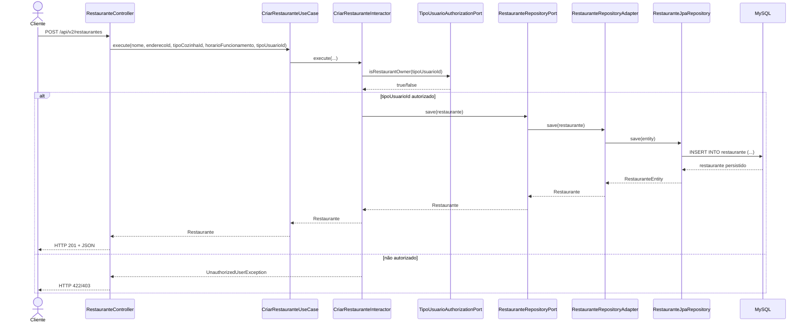

# Tech Challenge - Fase 2

Este repositório contém a especificação da API em **OpenAPI (Swagger)**.

## 📖 Documentação da API

A documentação interativa da API pode ser acessada pelo Swagger UI hospedado no GitHub Pages:

👉 [Visualizar documentação da API](https://onofresergio.github.io/tech-challenge-fase2/)

## 📂 Estrutura do repositório

```
src/main/java/br/com/fiap/techchallenge
├── domain
│   ├── exception
│   └── model
├── usecase
│   ├── assembler
│   ├── interactor
│   ├── port
│   │   ├── input
│   │   └── output
├── infrastructure
│   ├── configuration
│   ├── controller
│   │   ├── exception
│   │   ├── request
│   │   └── response
│   ├── database
│   │   ├── adapter
│   │   ├── entity
│   │   └── jpa
│   ├── security
│   └── validation
└── TechchallengeApplication.java
````
## 🚀 Como usar

1. Clone este repositório:
   ```bash
   git clone https://github.com/onofresergio/tech-challenge-fase1.git

## 🐳 Executando com Docker Compose

Este projeto já possui um arquivo `docker-compose.yaml` que facilita a execução da aplicação em containers.

### Passo a passo

1. Certifique-se de ter o **Docker** e o **Docker Compose** instalados em sua máquina.
    - [Instalar Docker](https://docs.docker.com/get-docker/)
    - [Instalar Docker Compose](https://docs.docker.com/compose/install/)

2. No diretório raiz do projeto, execute:
   ```bash
   docker-compose up --build -d

3. Para remover as imagens geradas pelo comando anterior
   ```bash
    docker-compose down -v

# Documentação Técnica da Solução

## 1. Visão geral do projeto

Este projeto consiste em uma API REST em Java com Spring Boot para gestão de usuários, endereços, tipos de usuário, tipos de cozinha, restaurantes e menus. A solução foi estruturada com foco em Clean Architecture, separando claramente regras de negócio, casos de uso e infraestrutura, com objetivo de facilitar manutenção, testes e evolução do sistema.

O sistema é pensado para apoiar operações típicas de um ambiente gastronômico, como:

- cadastro de usuários com perfil e endereço;
- definição de tipos de usuário e tipos de cozinha;
- cadastro de restaurantes vinculados a endereço e categoria culinária;
- gerenciamento de cardápios com disponibilidade e foto;
- validações de domínio e segurança de senhas mediante hash BCrypt;
- exposição de endpoints REST documentados com OpenAPI/Swagger.

A aplicação utiliza MySQL como banco de dados relacional, Spring Data JPA para persistência, e arquitetura baseada em portas e adaptadores para manter independência entre camada de negócio e tecnologia de infraestrutura.

## 2. Objetivo funcional da aplicação

A aplicação tem como objetivo centralizar o processo de gestão de um ambiente de restaurantes, permitindo:

- registrar dados de usuários e associá-los a endereço e tipo de perfil;
- manter catálogo de tipos de cozinhas e perfis de acesso;
- cadastrar restaurantes e relacioná-los a endereço, tipo culinário, tipo de usuário e horário de funcionamento;
- organizar itens de menu por restaurante;
- manter regras de negócio e validações em um único ponto de decisão, evitando lógica espalhada por controllers e repositories.

## 3. Arquitetura adotada: Clean Architecture

A solução foi organizada em camadas com dependência unidirecional, conforme o princípio da Clean Architecture:

- Domain: contém modelos, regras de validação e exceções que representam o núcleo do negócio;
- Use Case: concentra casos de uso e orquestração da regra de negócio;
- Infrastructure: implementa acesso a banco, segurança, configurações, controllers e adaptadores externos;
- Application entrypoints: endpoints REST expostos ao cliente.

Em termos práticos, a arquitetura adotada preserva a independência do domínio em relação à tecnologia de persistência, à segurança e aos frameworks de infraestrutura. Isso permite que a lógica de negócio seja testada e evoluída sem depender diretamente de detalhes de implementação externos.

### 3.1. Camada de domínio

A camada de domínio é o núcleo da solução. Nela estão os modelos record, como `Usuario`, `Restaurante`, `Menu`, `Endereco`, `TipoUsuario` e `TipoCozinha`, além das exceções específicas do negócio.

Esses modelos possuem validações automáticas em seus construtores, o que garante que entidades inválidas não alcancem o restante da aplicação. Exemplos:

- `Usuario` exige nome, e-mail válido, senha, login e IDs válidos de endereço e tipo de usuário;
- `Restaurante` exige nome, endereço, tipo de cozinha, horário e tipo de usuário;
- `Menu` valida nome, descrição, valor, disponibilidade e restaurante associado.

Esse padrão reduz a possibilidade de inconsistência e centraliza as regras de integridade do negócio em um único ponto.

### 3.2. Camada de casos de uso

A pasta `usecase` implementa a lógica de negócio. Os arquivos em `interactor` orquestram ações como:

- criação de usuário;
- atualização de dados do usuário;
- alteração de senha;
- listagem e busca por filtros;
- criação, atualização e remoção de restaurantes e menus;
- validação de e-mail único no cadastro e atualização.

Os contratos de entrada e saída ficam em `usecase/port/input` e `usecase/port/output`.

Esse desenho respeita a regra de inversão de dependência:

- a camada de casos de uso depende de interfaces (`ports`), não de detalhes de infraestrutura;
- a infraestrutura implementa essas interfaces em adapters e repositories.

### 3.3. Camada de infraestrutura

A camada de infraestrutura é a responsável por implementar as integrações concretas com o ambiente externo da aplicação. Em termos arquiteturais, ela não define a regra de negócio; ela materializa a execução da regra por meio de frameworks, bancos de dados, segurança, configuração e adaptação para protocolos de entrada e saída.

No projeto, essa camada está organizada em pacotes com responsabilidades bem definidas:

- `infrastructure.controller`: expõe os endpoints REST da API, recebe requisições e encaminha o fluxo para os casos de uso. Aqui ficam os controllers como `UsuarioController`, `RestauranteController`, `MenuController` e os DTOs associados;
- `infrastructure.controller.request` e `infrastructure.controller.response`: encapsulam as estruturas de entrada e saída da API, isolando a interface externa do modelo de domínio;
- `infrastructure.controller.exception`: concentra as exceções HTTP e os tratamentos de erro da camada de apresentação, permitindo respostas consistentes para o cliente;
- `infrastructure.database.entity`: representa as entidades JPA que mapeiam as tabelas do banco para a persistência relacional;
- `infrastructure.database.adapter`: implementa os adaptadores que conectam os ports do domínio às entidades JPA e aos repositórios concretos;
- `infrastructure.database.jpa`: reúne as interfaces de acesso ao banco fornecidas pelo Spring Data JPA;
- `infrastructure.configuration`: armazena configurações gerais da aplicação, beans, OpenAPI, e ajustes de infraestrutura;
- `infrastructure.security`: implementa autenticação, autorização e mecanismos de criptografia, como hash de senha e validação de perfis de usuário;
- `infrastructure.validation`: centraliza validações técnico-operacionais, como regras de integração e validação de entradas que não pertencem ao núcleo do domínio.

Essa separação é importante porque mantém a infraestrutura tecnicamente dependente do domínio, e não o contrário. Em outras palavras, a camada de negócio continua independente de Hibernate, Spring Data JPA, MySQL e bibliotecas de segurança; esses elementos apenas atendem aos contratos definidos pela aplicação.

Essa organização também reforça a ideia de adaptadores: o domínio define o que precisa ser realizado, enquanto a infraestrutura implementa como esse comportamento será executado no ambiente real. Por exemplo, o interactor de usuário não sabe se a persistência será feita via JPA, via JDBC ou via outro mecanismo; ele apenas utiliza um `port` que define a operação esperada. O `adapter` cuida da implementação específica para o banco e para a tecnologia escolhida.

### 3.4. Portas e adaptadores e a analogia com gateways

A aplicação usa o pattern Ports & Adapters para separar a lógica do negócio da tecnologia de persistência e autenticação. Em termos acadêmicos, essa abordagem equivale à ideia de gateways na Clean Architecture: elementos de fronteira que isolam o núcleo da aplicação de serviços externos, tecnologias de infraestrutura e detalhes de implementação.

A diferença principal é que, neste projeto, os gateways não foram implementados como classes literalmente chamadas `Gateway`; em vez disso, o conceito foi materializado por meio de interfaces de port e de suas implementações concretas em adapters. Essa escolha foi deliberada para manter a estrutura compatível com o padrão do Spring e com a organização de pacotes já definida no projeto.

Nesse contexto, os contratos de integração funcionam como gateways do domínio:

- `UsuarioRepositoryPort` atua como gateway de persistência do domínio de usuários. Ele define as operações de acesso ao banco sem expor detalhes de JPA, MySQL ou de implementação de repositório;
- `PasswordHasherPort` atua como gateway de segurança. Ele abstrai a rotina de hash de senha sem acoplar o domínio diretamente ao uso do `BCryptPasswordEncoder`;
- `UsuarioRepositoryAdapter` e `BCryptPasswordHasherAdapter` implementam os detalhes concretos dessas integrações com o ambiente externo.

Em termos práticos, o caso de uso (`UsuarioInteractor`) depende apenas de contratos que representam a interface do sistema com o ambiente externo. Não há acoplamento direto com JPA, com a base de dados ou com a biblioteca de criptografia. A lógica de negócio continua centrada em regras, validações e invariantes do domínio, enquanto a infraestrutura apenas executa aquilo que foi solicitado por meio de abstrações bem definidas.

Dessa forma, a solução preserva o princípio central da Clean Architecture: o núcleo da aplicação permanece independente da infraestrutura tecnológica. Essa abordagem favorece testes automatizados, facilita manutenção e permite evoluções de banco, criptografia e frameworks sem impactar diretamente a regra de negócio.

### 3.5. Princípios SOLID aplicados ao projeto

Além da organização em camadas da Clean Architecture, a solução também incorpora, de forma explícita, os princípios do SOLID como diretrizes de design. Esses princípios contribuem para a qualidade estrutural da aplicação e reforçam a coerência da arquitetura implementada.

O Princípio da Responsabilidade Única (SRP) é evidenciado pela separação entre `controller`, `interactor`, `port` e `adapter`. Cada componente concentra uma responsabilidade específica: entrada HTTP, regra de negócio, contrato de integração e implementação técnica, respectivamente. Essa divisão reduz o acoplamento e facilita a manutenção.

O Princípio da Inversão de Dependência (DIP) é o mais diretamente visível na solução. Os `interactors` dependem de interfaces como `UsuarioRepositoryPort` e `PasswordHasherPort`, e não de implementações concretas como `UsuarioJpaRepository` ou `BCryptPasswordEncoder`. Isso garante que a lógica de negócio não seja afetada por mudanças na infraestrutura.

O Princípio Aberto/Fechado (OCP) também é observado na estrutura de portas e adaptadores. A camada de negócio pode ser ampliada com novos comportamentos sem exigir alteração de componentes centrais, bastando a criação de novas implementações de infraestrutura que respeitem os contratos existentes. Isso torna o sistema mais extensível e menos vulnerável a regressões.

O Princípio da Segregação de Interfaces (ISP) é materializado pela especialização dos contratos. Em vez de uma interface ampla e genérica, o projeto define contratos específicos para cada domínio de integração, como `UsuarioRepositoryPort`, `RestauranteRepositoryPort`, `EnderecoRepositoryPort` e `PasswordHasherPort`. Essa granularidade evita dependências desnecessárias e mantém o design mais limpo e coerente.

O Princípio da Substituição de Liskov (LSP) também se aplica, na medida em que as implementações concretas dos ports respeitam os contratos definidos pela camada de uso. Qualquer implementação de um repositório ou adaptador de segurança deve ser substituível sem quebrar o comportamento esperado pelos `interactors`.

Em conjunto, esses princípios reforçam a qualidade do projeto e demonstram que a arquitetura escolhida não é apenas uma organização visual, mas uma decisão técnico-científica fundamentada em boas práticas de engenharia de software.

### 3.6. Testes unitários e integrados

A arquitetura adotada facilita de forma natural a criação de testes unitários e de integração, pois a lógica de negócio foi separada da infraestrutura tecnológica. Esse isolamento é um dos principais benefícios da Clean Architecture em projetos Java/Spring Boot: o núcleo do sistema pode ser validado sem depender diretamente de banco de dados ou de frameworks externos.

Os testes unitários são focados na avaliação dos comportamentos mais específicos da aplicação e podem ser aplicados, por exemplo, aos `interactors`, às entidades de domínio e às regras de validação. No projeto, a estrutura de `domain.model` e `usecase.interactor` torna esse tipo de teste simples e confiável porque os componentes principais não recebem acoplamento direto com JPA ou com a camada REST.

Exemplos de cenários apropriados para testes unitários:

- validação de criação de `Usuario` com dados inválidos;
- rejeição de e-mail em formato inválido;
- criação de `Restaurante` sem campos obrigatórios;
- comportamento de `CriarRestauranteInteractor` quando o tipo de usuário não é autorizado;
- persistência de regras de negócio em operações como atualização de senha ou cadastro de menu.

Esses testes verificam a lógica de domínio e de aplicação sem depender da infraestrutura. Como os `interactors` utilizam `ports`, é possível substituir implementações concretas por mocks ou stubs durante os testes, mantendo a execução do comportamento de negócio isolada.

Os testes de integração, por sua vez, têm como objetivo verificar a interação entre as camadas do sistema em um cenário mais próximo do ambiente real. No contexto do projeto, isso inclui o fluxo completo de uma requisição HTTP, passando pelo `controller`, pelo `interactor`, pela persistência em banco e pela resposta final em JSON.

Esse tipo de teste é especialmente relevante para validar:

- endpoints expostos pela API REST;
- serialização e desserialização de DTOs;
- tratamento de exceções em `controller.exception`;
- integração com Spring Boot e com o contexto da aplicação;
- persistência efetiva em banco relacional via JPA;
- autorização e validação de regras de negócio em cenários completos.

A arquitetura com `controller -> usecase -> port -> adapter -> JPA` favorece esse tipo de validação porque cada camada tem uma responsabilidade bem definida. O teste de integração pode montar o contexto da aplicação, enviar uma requisição real e verificar se a resposta e o comportamento final são coerentes com a regra de negócio prevista.

Em termos práticos, a proposta da solução é combinar as duas estratégias:

- testes unitários para validar regras de negócio de forma rápida e isolada;
- testes de integração para validar o comportamento real do sistema em conjunto, incluindo infraestrutura e comunicação entre componentes.

Essa combinação melhora a confiabilidade da aplicação, reduz regressões e reforça a qualidade do código em um projeto de arquitetura modular e extensível.

## 4. Fluxo de execução da aplicação

Um fluxo típico da API segue este caminho:

1. O cliente envia uma requisição HTTP para um controller REST;
2. O controller recebe o payload e valida campos básicos com Bean Validation;
3. O controller chama um caso de uso (`interactor`);
4. O interactor aplica regras de negócio e usa portas de saída para persistência e infraestrutura;
5. O adapter de infraestrutura acessa o banco por JPA;
6. O domínio retorna um objeto validado;
7. O assembler transforma o modelo em uma resposta REST;
8. A resposta é devolvida ao cliente em JSON.

Esse fluxo mostra, de forma prática, a função dos gateways conceituais da Clean Architecture: o caso de uso não conhece a tecnologia externa, mas depende de contratos que representam as integrações necessárias. Em outras palavras, os ports funcionam como fronteiras de abstração entre o domínio e o mundo externo.

A seguir, um diagrama de sequência que ilustra o fluxo de criação de um restaurante, destacando a separação entre a camada de apresentação, a camada de casos de uso e a infraestrutura:



Exemplo de fluxo de cadastro de restaurante:

- `RestauranteController.create(...)`
- chama `CriarRestauranteUseCase.execute(...)`
- `CriarRestauranteInteractor.execute(...)`
- valida autorização do tipo de usuário
- cria `Restaurante` no domínio
- salva via `RestauranteRepositoryPort`
- persiste no banco por JPA
- retorna a resposta serializada para o cliente

## 5. Funcionalidades do sistema

### 5.1. Gestão de usuários

Endpoints principais:

- `POST /api/v2/usuarios`: cria usuário;
- `PUT /api/v2/usuarios/{id}`: atualiza dados do usuário;
- `PUT /api/v2/usuarios/{id}/senha`: altera a senha;
- `GET /api/v2/usuarios`: lista todos;
- `GET /api/v2/usuarios/{id}`: busca por ID;
- `GET /api/v2/usuarios/nome/{nome}`: busca por nome parcial;
- `DELETE /api/v2/usuarios/{id}`: remove usuário.

Regras de negócio relevantes:

- email deve ser único;
- senha armazenada com hash BCrypt;
- nome, e-mail e login são obrigatórios;
- ao atualizar usuário, a senha antiga é preservada e não é reaproveitada em outra chamada de atualização de dados.

### 5.2. Gestão de tipos de usuário

- `POST /api/v2/tipo-usuario`
- `PUT /api/v2/tipo-usuario/{id}`
- `GET /api/v2/tipo-usuario`
- `GET /api/v2/tipo-usuario/{id}`
- `DELETE /api/v2/tipo-usuario/{id}`

Essencial para categorizar perfis de acesso ou papéis dentro do contexto do restaurante.

### 5.3. Gestão de endereços

- `POST /api/v2/enderecos`
- `PUT /api/v2/enderecos/{id}`
- `GET /api/v2/enderecos`
- `GET /api/v2/enderecos/{id}`
- `DELETE /api/v2/enderecos/{id}`

A entidade de endereço é reutilizada por usuários e restaurantes, promovendo consistência e reduzindo duplicação de informações.

### 5.4. Gestão de restaurantes

- `POST /api/v2/restaurantes`
- `PUT /api/v2/restaurantes/{id}`
- `GET /api/v2/restaurantes`
- `GET /api/v2/restaurantes/{id}`
- `DELETE /api/v2/restaurantes/{id}`

Dados principais:

- nome do restaurante;
- endereço cadastrado;
- tipo de cozinha;
- horário de funcionamento;
- vínculo com tipo de usuário.

A criação do restaurante envolve relacionamento com outras entidades centrais, permitindo composição de dados com maior riqueza sem acoplamento excessivo.

### 5.5. Gestão de tipos de cozinha

A categoria de cozinha permite segmentar o cardápio e o tipo de restaurante. Embora o código tenha estrutura para esse conceito, a API expõe a capacidade de manter esse repertório e usá-lo nos restaurantes.

### 5.6. Gestão de menus

- `POST /api/v2/menus`
- `PUT /api/v2/menus/{id}`
- `GET /api/v2/menus`
- `GET /api/v2/menus/{id}`
- `DELETE /api/v2/menus/{id}`

Cada item do menu inclui:

- nome do prato;
- descrição;
- valor;
- disponibilidade no restaurante;
- link ou campo de foto;
- restaurante associado.

## 6. Segurança e validação

### 6.1. Hash de senha

A senha do usuário é protegida com `BCryptPasswordEncoder`, implementado por meio de `SecurityConfig` e `BCryptPasswordHasherAdapter`.

Isso garante:

- que a senha do usuário nunca seja armazenada em texto puro;
- que a aplicação siga boas práticas de segurança;
- que a validação de login e autenticação podem evoluir sem alterar o núcleo de negócios.

### 6.2. Validação de dados

A validação é distribuída entre:

- Bean Validation nos DTOs/requests;
- validações de domínio nos records;
- `GlobalExceptionHandler` para tratamento centralizado de exceções.

Isso permite:

- respostas padronizadas para erros de negócio;
- menor espalhamento de `if`s e `throw`s pelo código;
- melhor qualidade na experiência de uso da API.

### 6.3. Tratamento de exceções

A classe `GlobalExceptionHandler` centraliza erros como:

- entidade não encontrada;
- regra de negócio violada;
- e-mail duplicado;
- dados inválidos.

Esse mecanismo produz respostas consistentes ao cliente, reduzindo acoplamento entre controller e regras de negócio.

## 7. Persistência e banco de dados

A aplicação usa MySQL com Spring Data JPA. A configuração em `application.yaml` define:

- URL do banco;
- usuário e senha;
- driver MySQL;
- Hibernate em modo `validate`;
- habilitação de log SQL.

A estrutura de persistência é dividida em:

- `infrastructure/database/entity`: entidades JPA;
- `infrastructure/database/jpa`: interfaces `JpaRepository`;
- `infrastructure/database/adapter`: adaptadores entre entidades e modelos do domínio.

Esse desenho separa o modelo de domínio do mapeamento JPA, mantendo a camada de negócio mais limpa e menos dependente do banco.

## 8. Documentação da API

A aplicação expõe documentação interativa via Swagger/OpenAPI. A configuração de OpenAPI está em `OpenApiConfiguration`, e a API pode ser acessada diretamente pelos controllers com anotações como `@Operation` e `@ApiResponse`.

A documentação facilita:

- testes manuais dos endpoints;
- entendimento da API por desenvolvedores e stakeholders;
- validação para professores e avaliadores.

## 9. Testes e qualidade

O projeto inclui testes automatizados em vários níveis, incluindo:

- testes unitários de domínio;
- testes de casos de uso;
- testes de controladores;
- testes de adaptadores de persistência;
- testes de integração com RestAssured;
- testes com Testcontainers para simular ambiente MySQL.

A existência de testes em múltiplas camadas reforça a qualidade da aplicação e facilita a evolução segura do software.

## 10. Benefícios da arquitetura aplicada

A decisão por Clean Architecture trouxe benefícios claros:

- baixa acoplamento entre regras de negócio e infraestrutura;
- facilidade de substituição de banco de dados ou tecnologia de autenticação;
- maior testabilidade;
- maior clareza de responsabilidade por camada;
- menor risco de regressão em mudanças futuras;
- melhor organização para desenvolvimento em equipe;
- manutenção da independência do domínio em relação a serviços externos e frameworks.

Essa abordagem também torna explícita a lógica de gateways e fronteiras de integração: os ports e adapters isolam o núcleo da aplicação, preservando a coerência arquitetural e permitindo que mudanças na tecnologia não reflitam diretamente no comportamento de negócio.

## 11. Conclusão

A solução demonstra uma aplicação Java com Spring Boot seguindo boas práticas de arquitetura, separando domínio, casos de uso e infraestrutura de forma consistente. O projeto não é apenas uma API funcional, mas um exemplo de desenho arquitetural que prioriza manutenção, extensibilidade e qualidade de código.

A combinação de regras de negócio centralizadas, ports and adapters, persistência JPA, criptografia BCrypt, documentação OpenAPI e testes automatizados torna a solução adequada para apresentação acadêmica e para evolução em projetos reais de software.
